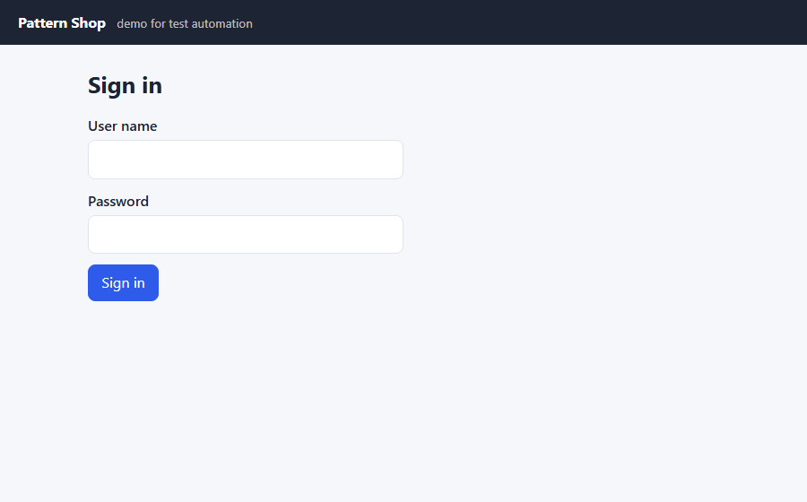
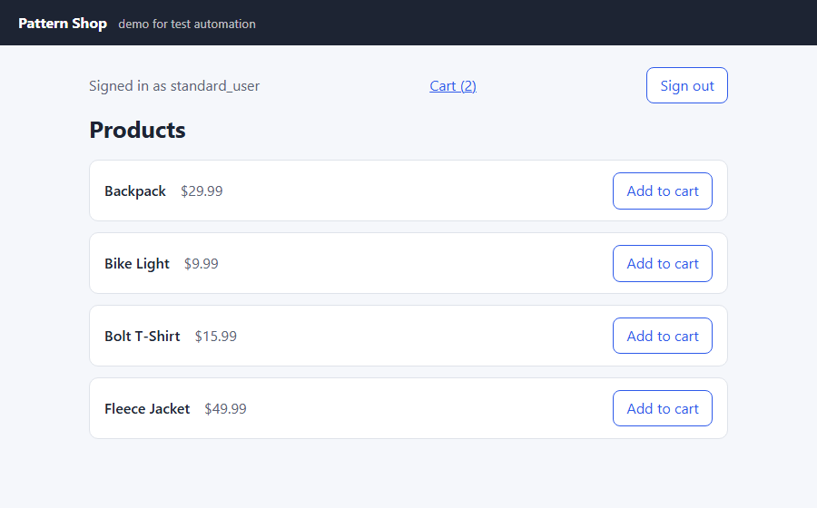
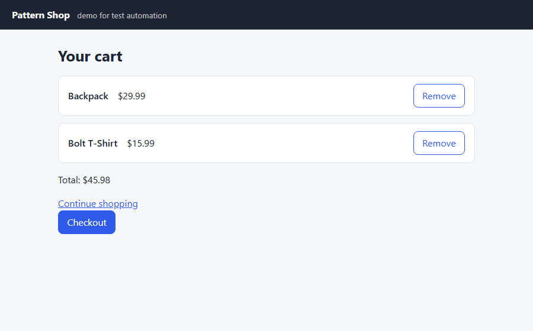
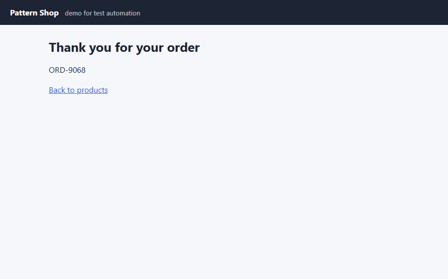
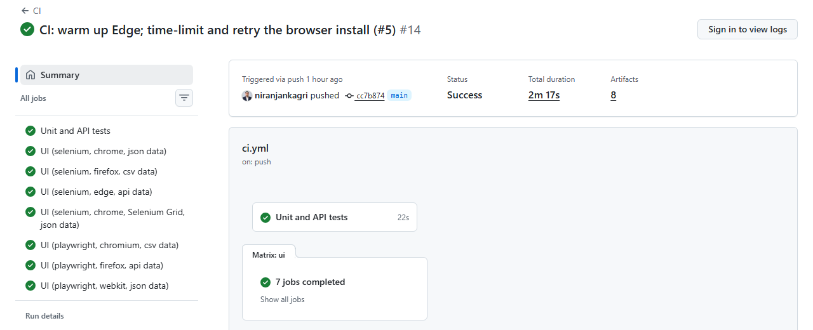

# Design patterns in a test automation framework

[](https://github.com/niranjankagri/design-patterns-test-framework/actions/workflows/ci.yml)

A Java test framework built to show five design patterns doing real work: **Page Object, Factory, Strategy, Adapter
and Observer**. The same UI tests run on **Selenium WebDriver** and on **Playwright for Java**, on seven browser
setups, against the [Pattern Shop](https://github.com/niranjankagri/pattern-shop-demo-app), a small demo shop that
CI starts as a Docker image next to the tests (also hosted: https://pattern-shop.onrender.com).

| | |
|---|---|
| Language | Java 21, Maven (wrapper included) |
| Engines | Selenium 4.53 (Chrome, Firefox, Edge, Selenium Grid) and Playwright 1.65 (Chromium, Firefox, WebKit) |
| Tests | TestNG 7.12, AssertJ: 37 tests (26 unit and API, 11 UI) |
| Application | [Pattern Shop](https://github.com/niranjankagri/pattern-shop-demo-app): pages, REST, SOAP-style XML and a legacy text API |

## The five patterns

| # | Pattern | Problem it solves here | Where |
|---|---|---|---|
| 01 | **Page Object** | Tests should read like user steps; locators and page actions live in one place, assertions stay in the tests | [`pages/`](src/main/java/com/niranjankagri/patterns/pages): `LoginPage`, `ProductsPage`, `CartPage`, `OrderCompletePage` |
| 02 | **Factory** | One place turns the run configuration into a started browser: local or remote driver, Selenium or Playwright | [`BrowserFactory`](src/main/java/com/niranjankagri/patterns/browser/BrowserFactory.java) |
| 03 | **Strategy** | Swap how test data is loaded (JSON, CSV or the shop's test-data API) without touching a test | [`data/`](src/main/java/com/niranjankagri/patterns/data): `TestDataSource` + 3 implementations, chosen by `data.source` |
| 04 | **Adapter** | Different APIs behind one interface the tests expect: two browser engines, and three catalog client APIs | [`Browser`](src/main/java/com/niranjankagri/patterns/browser/Browser.java) ← `SeleniumBrowser`, `PlaywrightBrowser`; [`CatalogClient`](src/main/java/com/niranjankagri/patterns/clients/CatalogClient.java) ← REST, SOAP, legacy SDK |
| 05 | **Observer** | Reporting, logging, metrics and screenshots react to test events without being called by the tests | [`events/`](src/main/java/com/niranjankagri/patterns/events): `TestEventBus`, 4 listeners, `TestNgEventBridge` |

How they fit together in one UI test:

```text
run config ──▶ BrowserFactory ──▶ Browser (Selenium or Playwright adapter)        02 Factory, 04 Adapter
                                     ▲
test ──▶ LoginPage / ProductsPage ───┘  (no locators or waits in the test)        01 Page Object
  ▲
  └── users, products ◀── TestDataSource (json | csv | api)                       03 Strategy

TestNG ──▶ TestNgEventBridge ──▶ TestEventBus ──▶ report.md, log, metrics.json,    05 Observer
                                                  failure screenshots
```

More detail, with the reasons and the alternatives that were not chosen: [docs/design-patterns.md](docs/design-patterns.md).

## The pages under test

One page object per shop page; each action returns the page it leads to.

| `LoginPage` | `ProductsPage` |
|---|---|
|  |  |
| **`CartPage`** | **`OrderCompletePage`** |
|  |  |

## Run it

Start the shop (any of these), then run the tests:

```bash
docker run -d -p 8080:8080 ghcr.io/niranjankagri/pattern-shop-demo-app:latest   # the image CI uses
# or: clone pattern-shop-demo-app and run ./mvnw package && java -jar target/pattern-shop.jar
# or, without Docker, the hosted demo (it may need a minute to wake up):
#   ./mvnw verify -Dapp.url=https://pattern-shop.onrender.com

./mvnw verify                                             # all 37 tests, Selenium + Chrome, JSON data
./mvnw verify -Dengine=playwright -Dbrowser=webkit        # the same UI tests on Playwright WebKit
./mvnw verify -Dsuite=ui -Dbrowser=firefox -Ddata.source=csv
./mvnw verify -Dsuite=core                                # unit and API tests only, no browser
```

Selenium Grid (the factory's remote branch):

```bash
docker run -d -p 4444:4444 --shm-size=2g selenium/standalone-chrome:4.52.0-20261101
./mvnw verify -Dsuite=ui -Dremote=true -Dapp.url=http://host.docker.internal:8080
```

The browser runs inside the Grid container, so `app.url` must be an address the container can reach. On Windows,
port 4444 can be reserved by the system; map another one (`-p 14444:4444 ... -Dgrid.url=http://localhost:14444`).

Playwright downloads its browsers on first use. On Linux, install the system libraries once with
`./mvnw test-compile org.codehaus.mojo:exec-maven-plugin:3.7.0:java -Dexec.classpathScope=test -Dexec.mainClass=com.microsoft.playwright.CLI -Dexec.args="install --with-deps"`.

### Options

| Property | Values | Default |
|---|---|---|
| `engine` | `selenium`, `playwright` | `selenium` |
| `browser` | Selenium: `chrome`, `firefox`, `edge`; Playwright: `chromium`, `firefox`, `webkit` | `chrome` / `chromium` |
| `headless` | `true`, `false` | `true` |
| `remote` | `true` = Selenium Grid at `grid.url` (Selenium only) | `false` |
| `grid.url` | Grid address | `http://localhost:4444` |
| `app.url` | the shop: local container, CI container or the hosted demo | `http://localhost:8080` |
| `data.source` | `json`, `csv`, `api` | `json` |
| `suite` | `all`, `core` (unit + API), `ui` | `all` |
| `timeout.seconds` | how long an element may take to appear | `10` |

System properties win over [`framework.properties`](src/test/resources/framework.properties). An engine and browser
that do not fit together (`-Dengine=playwright -Dbrowser=chrome`) stop the run before a browser starts, with the
list of supported browsers.

## Outputs

Every run writes, through the Observer listeners:

- `target/test-events/report.md`: summary and one row per test (CI adds it to the job summary)
- `target/test-events/metrics.json`: outcome counts, test time, slowest test
- `target/test-events/screenshots/`: a PNG per failed UI test
- one log line per test: `INFO: PASSED TC-301 the cart lists the added products and their total (412 ms)`

## Tests

| IDs | What | Runs on |
|---|---|---|
| TC-101..104 | sign-in outcome per user from the data source, wrong password, empty fields, sign-out | each engine/browser |
| TC-201..202 | catalog names and prices, cart counter | each engine/browser |
| TC-301..303 | cart items and total, remove, checkout | each engine/browser |
| TC-401..404 | the same catalog checks through the REST, SOAP and legacy adapters | core |
| TC-501..503 | the three data sources return the same data; selection by name | core |
| TC-601..604 | factory validation and browser options; configuration overrides | core |
| TC-701..706 | event delivery, failing-listener isolation, unsubscribe, service loading, report, metrics | core |
| TC-801..803 | adapter translations: names, cents, legacy error strings | core |

## CI

[`ci.yml`](.github/workflows/ci.yml): on every pull request, push to `main`, weekly (Friday 23:30 UTC) and on demand.
One job runs the unit and API tests; seven jobs run the UI tests on Selenium Chrome, Firefox, Edge and Chrome on
Selenium Grid, and on Playwright Chromium, Firefox and WebKit, spread over the three data sources. Each job starts the
shop image from ghcr.io first, so no job depends on a public site. Results and failure screenshots are kept as
artifacts.



## A real problem the two engines found

The first Selenium Chrome run failed every test that clicked twice after signing in, while Playwright's Chromium
passed the same tests. The cause: Chrome's password manager recognised the demo password from a known data breach and
opened a "change your password" dialog, which swallowed the next click. The fix belongs in the Factory (Chrome and
Edge start with the password manager off), and TC-603 keeps it there. Running one set of tests on two engines makes
this kind of environment problem visible instead of looking like a flaky test.

## License

[MIT](LICENSE)
